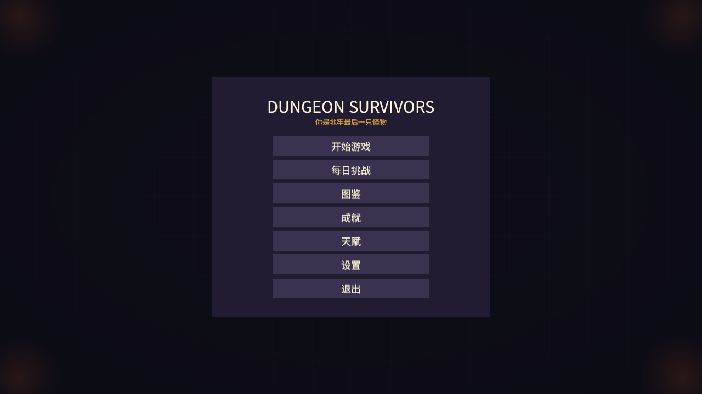
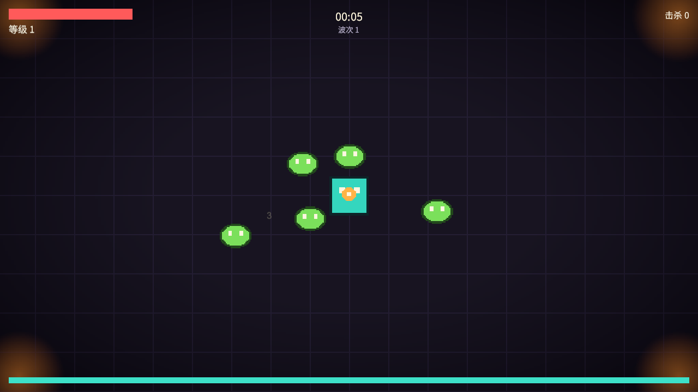
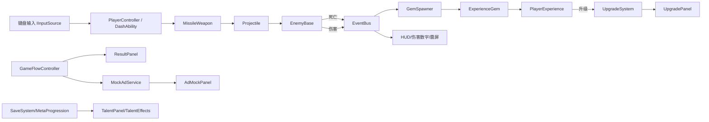

# 地牢幸存者 / Dungeon Survivors

> **2D 俯视角割草 Roguelite · 个人求职作品集项目**
> 你是地牢里最后一只幸存的怪物。一波波"勇者"下来刷装备，你要在越来越强的怪潮里活下来，杀掉他们、夺走他们的武器和变异，变成更强的怪物。

> 截图（角色/动画已换正式像素素材；仓库默认使用占位图，完整美术版见本地 `Builds/Stable_v0.2`）：
>
> 
> 

---

## 一、项目状态

| 项 | 状态 |
|---|---|
| 阶段 | **v0.2.1 稳定预览版**（修复 UI 点击：补 EventSystem；玩法闭环 + 本地美术版：史莱姆主角 + 勇者敌人 + 四方向帧动画 + 中文 UI） |
| 引擎 | **Unity 2022.3.62f3c1** + C#（Built-in 2D 渲染管线） |
| 平台 | Windows PC（架构预留移动端/小游戏） |
| 单局时长 | 8–12 分钟 |
| 可玩构建 | `Builds/Windows/DungeonSurvivors.exe`（美术版）；稳定版备份 `Builds/Stable_v0.2.1/` |

## 二、已实现功能

**核心玩法**
- 8 方向移动 + 闪避（无敌帧/冷却/残影位）
- 自动索敌追踪弹武器（冷却、目标死亡/超时回收）
- 第二把武器：环绕飞刀（升级解锁，绕身旋转造成范围伤害）
- 敌人 FSM：Idle / Chase / Attack / Hurt / Die；接触伤害、受击闪白
- 波次刷新：每 15 秒一波、数量/血量/移速随波次成长、同屏上限
- 精英 / Boss 波次：每 3 波出精英（高血/高伤/更多经验），每 5 波出 Boss（体型/血量 ×20）
- 经验宝石掉落 + 磁吸拾取 + 升级三选一（暂停选择、候选去重）
- 打击感：受击闪白、伤害数字、震屏、**顿帧**、**全屏闪**、**镜头 zoom punch**、**击退**
- 氛围：程序生成暗角（vignette）+ 四角火把光晕闪烁（Perlin 噪声），零美术成本的暗黑地牢感
- 结算面板（时间/击杀/等级）+ 重开 + 暂停菜单
- 胜利条件：击败**第 10 波 Boss** → `VICTORY`（灵魂 ×2）；死亡 → `RUN OVER`

**完整游戏壳**
- 主菜单 7 项：开始游戏 / 每日挑战 / 图鉴 / 成就 / 天赋 / 设置 / 退出
- 每日挑战：按日期固定词缀（敌人移速 +25%、灵魂收益 +50%），HUD 显示 `DAILY`
- 图鉴：武器 / 敌人（普通/精英/Boss）/ 变异三类收集，主菜单查看
- 成就系统：6 个成就（首杀/单局 50 杀/5 级/首次死亡/广告复活/首个天赋）
- 新手引导：首次进入显示操作说明（WASD/空格/自动攻击/ESC/F1）
- 天赋树：4 个局外天赋（伤害/血量/移速/攻速），灵魂货币升级，开局生效
- 设置：音量 5 档 + 全屏开关（持久化）
- 存档：JSON + 版本号 + 迁移入口 + 损坏兜底
- 中文 UI：内置 Noto Sans CJK 字体（OFL 授权）

**小游戏商业化（Mock）**
- `IAdService` 接口 + `MockAdService`（3 秒假广告面板）
- 死亡后看广告复活（50% 血 + 2 秒无敌）
- 结算发放灵魂货币（击杀 ×2 + 等级 ×5）

**数据与统计**
- 本地埋点：局数/击杀/广告/复活/升级选择
- 开发者数据面板（游戏内按 `F1` 打开）

**工程化**
- 事件总线解耦 UI 与逻辑
- 泛型对象池（敌人/子弹/经验/伤害数字）
- 编辑器一键场景生成（`DungeonSurvivors → Setup Scene (W1)`）
- 一键 Windows 打包（`DungeonSurvivors → Build Windows x64`）
- 占位美术自动生成（无需等待素材即可开发）

## 三、操作

| 输入 | 行为 |
|---|---|
| WASD / 方向键 | 移动 |
| 空格 | 闪避 |
| Esc | 暂停 |
| F1 | 开发者数据面板 |

## 四、如何运行

**方式一（推荐）**：双击 `Builds/Windows/DungeonSurvivors.exe`

**方式二（Unity）**：
1. Unity Hub 用 **2022.3.62f3c1** 打开本目录
2. 打开 `Assets/_Project/Scenes/Main.unity`
3. Play

## 五、架构

```
Assets/_Project/
  Scripts/
    Core/          GameManager, EventBus, ObjectPool, SaveSystem, SaveData, MetaProgression
    Data/          ScriptableObject 配置（规划中）
    Gameplay/
      Player/      PlayerController, DashAbility, PlayerHealth
      Weapons/     MissileWeapon, Projectile
      Enemies/     EnemyBase(FSM), EnemySpawner(波次)
      Combat/      IDamageable
      Progression/ PlayerExperience, ExperienceGem, GemSpawner, UpgradeSystem, UpgradeOption
      Waves/       （并入 EnemySpawner）
    Commerce/      IAdService, MockAdService
    Analytics/     AnalyticsService
    UI/            HUD, MainMenu, TalentPanel, SettingsPanel, UpgradePanel, CodexPanel,
                   ResultPanel, PausePanel, AdMockPanel, DamageNumberSpawner, DevDataPanel
    Visual/        DirectionalSpriteAnimator（四方向帧动画）
    Systems/       CameraFollow, CombatFeedback, GameFlowController, RunStats,
                   TalentCatalog, TalentEffects, Achievement/Codex/DailyChallenge
    Editor/        Day0SceneSetup（一键场景/美术场景）, BuildScript（一键打包）,
                   CraftpixSpriteImporter（素材导入规则）
  Prefabs/  Config/  Art/  Audio/  Scenes/  Settings/
Assets/ThirdParty/  免费/购买素材（保留 LICENSE，不提交公开仓库）
```

**数据流（简图）**



## 六、技术亮点（简历/面试主打）

1. **对象池 + 事件驱动**：敌人/子弹/经验宝石/伤害数字全部池化；UI 主要通过事件订阅，逻辑层不引用 UI。
2. **数据/表现分离的伤害反馈管线**：`EnemyBase.TakeDamage` 只发 `DamageDealtEvent`，伤害数字、震屏、统计各自订阅。
3. **存档版本迁移**：`SaveData.version` + `SaveSystem.Migrate`，保证旧存档可用；读档失败兜底默认值。
4. **商业化接口抽象**：`IAdService` 接口 + Mock 实现，真接 SDK 时不动业务代码。
5. **本地埋点 + 开发者数据面板**：为"用数据调难度"预留分析能力。
6. **一键场景/打包**：`Day0SceneSetup` / `BuildScript`，把重复操作自动化。

**实测性能（2026-10-26，自动压测可复现）**

- 机器：Intel i7-11800H / GTX 1050 Ti / 16 GB / Windows 11
- 条件：1280×720 窗口（前台）、VSync off、**200 敌人同屏追击**（关闭玩家武器，隔离敌人负载）存活 10 秒（预热 1 秒）
- 结果（200 敌人）：**平均帧时间 0.41 ms（≈2410 FPS 无上限）**，p50 0.38 ms，p95 0.60 ms，**p99 1.25 ms**，最差 5.79 ms；**平均 DrawCall 9**
- 规模曲线（平均帧时间）：50 敌人 **0.27 ms** / 100 **0.28 ms** / 200 **0.41 ms** / 300 **0.57 ms** / 500 **0.75 ms**——线性增长，全部远低于 60 FPS 的 16.67 ms 预算
- 结论：CPU 帧时间在 500 敌人时仍只有 60 FPS 预算的 1/22；CSV 与工具命令见下文
- 待补：GC Alloc（Profiler 手动记录；`ProfilerRecorder` 的 GC 计数器在 2022.3 不可用）

## 七、开发与打包

```powershell
# 重新生成场景（会覆盖 Main.unity）
Unity.exe -batchmode -quit -projectPath "<project>" `
  -executeMethod DungeonSurvivors.EditorTools.Day0SceneSetup.Run -logFile "Logs/setup.log"

# 打包 Windows x64
Unity.exe -batchmode -quit -projectPath "<project>" `
  -executeMethod DungeonSurvivors.EditorTools.BuildScript.BuildWindows -logFile "Logs/build.log"
```

开发/录制辅助参数：`-autoStart` 跳过主菜单直接开局；`-stressTest -stressEnemies N -stressDuration S` 自动压测并输出 CSV。

### 本地美术版（Craftpix / Kenney 素材）

- 第三方素材放在 `Assets/ThirdParty/`（已在 `.gitignore`，不随公开仓库分发，遵循授权条款）
- 一键生成**美术场景**（会生成 `MainArt.unity` + 美术 Prefab，均不提交仓库）：

```powershell
Unity.exe -batchmode -quit -projectPath "<project>" `
  -executeMethod DungeonSurvivors.EditorTools.Day0SceneSetup.Run -art -logFile "Logs/setup_art.log"
```

- `BuildScript` 会自动检测 `MainArt.unity`：存在则构建美术版，否则构建占位版（保证 clone 后仍可玩）
- 导入规则由 `CraftpixSpriteImporter`（AssetPostprocessor）自动配置：64×64 网格切片、Point 采样、无压缩
- 角色动画由 `DirectionalSpriteAnimator` 播放：按位移判断朝向/移动，四方向 Idle/Run

## 七点五、已知限制（v0.2 稳定版）

- 地面/围墙/UI 仍是程序生成占位（地牢 Tileset、像素 UI 已下载，待接入）
- 暂无音效（Kenney impact / rpg audio 已下载，待接入）
- 攻击/死亡特效仍是闪白 + 伤害数字（爆炸/魔法序列帧待接入）
- Boss 暂用放大染色的勇者精灵（Warrior 4 方向 Boss 待接入）
- 内容量：1 张地图、2 把武器、1 种敌人（普通/精英/Boss 三档）、4 天赋、6 成就、11 图鉴项
- 性能数据基于占位版；美术版接入完成后需复测

## 八、素材与授权

- 当前公开仓库内为程序生成占位像素图（可自由使用）
- 本地美术版使用 Craftpix 免费包（Slime / Base Male 4-direction）+ Kenney 素材，授权文件随素材保留
- **公开仓库不提交第三方付费/免费素材源文件**（遵循各平台"禁止再分发"条款）；`Docs/screenshots` 为本地美术版截图
- 字体：Noto Sans CJK（SIL OFL 1.1），随仓库提供

## 九、文档

- 技术文档：`Docs/02-技术文档.md`
- 视觉与打击感规范：`Docs/04-视觉与打击感规范.md`
- 立项/任务卡/面试材料：保存在本地开发工作区（不随公开仓库提供）

## 十、License / Credits

- 代码：MIT License，见 [`LICENSE`](LICENSE)
- 素材与工具说明：见 [`CREDITS.md`](CREDITS.md)
- 当前美术为程序生成占位图，正式素材接入后会在 Credits 中登记来源与授权。

---

> 本项目为个人求职作品集项目，代码为本人编写（AI 辅助开发，核心模块逐行评审），素材来源将在正式版 Credits 中注明。
